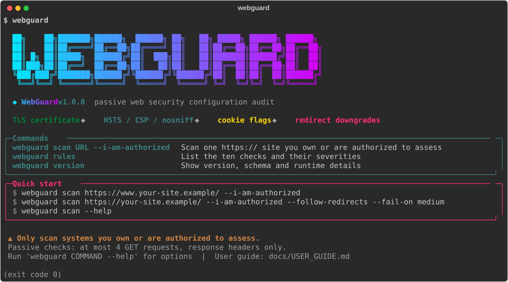
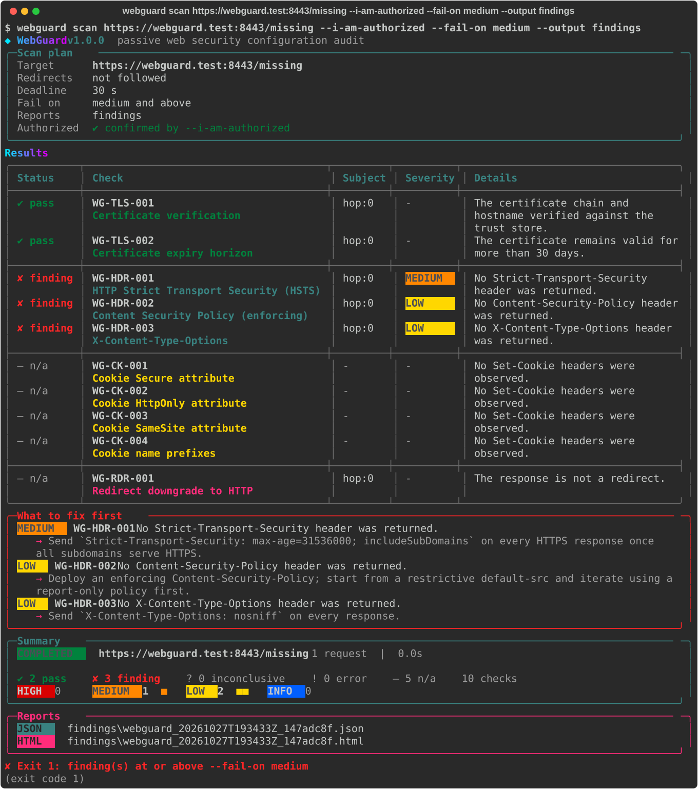

# WebGuard

WebGuard checks how securely a website is set up for visitors. Give it one `https://` address and it checks the
TLS certificate, the HSTS, Content-Security-Policy and X-Content-Type-Options headers, cookie flags, and whether
HTTPS pages redirect to plain HTTP. It prints a summary and saves a JSON and an HTML report.

> **Authorization.** WebGuard only scans systems you own or are authorized to assess. Every scan requires the
> `--i-am-authorized` flag.
>
> **Passive, not a penetration test.** WebGuard sends at most four ordinary `GET` requests, reads only the response
> headers, and never attacks, crawls or logs in. Passing checks do not mean the site is secure.

**Full instructions: [User guide](docs/USER_GUIDE.md)**

<p align="center"></p>

Day 5 of the *7 Days – 7 Builds* series (after NetScope, TraceDNS, FileSift and AuthWatch).

## Install

Requires Python 3.12, 3.13 or 3.14 on Linux, macOS or Windows.

```console
$ git clone https://github.com/PranavY-01/WebGuard
$ cd WebGuard
$ pipx install .             # or, inside a virtual environment: python -m pip install .
$ webguard version
WebGuard 1.0.0 (report schema 1.0)
```

## Quick start

```console
$ webguard scan https://www.your-site.example/ --i-am-authorized
```

Real output from a scan of WebGuard's local test server, whose page lacks its security headers:

<p align="center"></p>

The same output as plain text is in [`samples/cli-scan-findings.txt`](samples/cli-scan-findings.txt). Run
`webguard` with no arguments for the welcome screen, and `webguard scan --help` for every option.

Each finding is explained, with how to fix it, in the [user guide](docs/USER_GUIDE.md#8-the-ten-checks-and-how-to-fix-them).
More example output and complete sample reports are in [`samples/`](samples/).

## Commands

| Command | What it does |
|---|---|
| `webguard scan URL --i-am-authorized [options]` | Scans one URL and writes a JSON and an HTML report. |
| `webguard rules` | Lists the ten checks. |
| `webguard version` | Shows the version. |

| Option | Default | Meaning |
|---|---|---|
| `--follow-redirects` | off | Follow up to 3 HTTPS redirects, re-checking each one. |
| `--deadline SECONDS` | 30 | Time limit for the whole scan (5–120). |
| `--fail-on LEVEL` | high | Exit 1 when a finding is at least `informational`, `low`, `medium` or `high`; `none` never does. |
| `--output DIR` | `reports` | Where reports are saved (never overwritten). |
| `--debug` | off | Diagnostic output on stderr (never secrets). |

## The ten checks

| ID | Checks | Finding severities |
|---|---|---|
| `WG-TLS-001` | Certificate is trusted, valid and matches the hostname. | high |
| `WG-TLS-002` | Certificate is not about to expire. | low, medium |
| `WG-HDR-001` | HSTS is present with a long enough `max-age`. | low, medium |
| `WG-HDR-002` | An enforcing Content-Security-Policy is present. | low |
| `WG-HDR-003` | `X-Content-Type-Options: nosniff` is present. | low |
| `WG-CK-001` | Cookies have `Secure`. | medium |
| `WG-CK-002` | Cookies have `HttpOnly`. | low |
| `WG-CK-003` | Cookies have a sensible `SameSite`. | informational, low, medium |
| `WG-CK-004` | `__Secure-` / `__Host-` cookies meet their requirements. | medium |
| `WG-RDR-001` | HTTPS pages don't redirect to plain HTTP. | medium |

Rule reference with every reason code: [`docs/RULES.md`](docs/RULES.md).

## Exit codes

`0` nothing at or above `--fail-on` · `1` findings at or above `--fail-on` · `2` usage error or missing
`--i-am-authorized` · `3` target refused before anything was sent · `4` scan failed or partial ·
`5` reports couldn't be written · `70` internal error · `130` interrupted.
Details: [user guide, section 10](docs/USER_GUIDE.md#10-using-webguard-in-ci-and-scripts).

## Good to know

- Only public `https://` sites on ports 443 or 8443. Private, internal and loopback addresses are refused, and
  there is no option to change that.
- Certificates are always fully verified against the `certifi` trust store; there is no "insecure" mode.
- Cookie values are never stored, and query values are hidden in reports. URL paths are kept as given.
- Response bodies are never read, so CSP set in a `<meta>` tag isn't seen, and CSP strength isn't graded.

## Project

- [User guide](docs/USER_GUIDE.md) · [Rule reference](docs/RULES.md) · [Samples](samples/)
- [Security policy](SECURITY.md) · [Changelog](CHANGELOG.md) · [Contributing](CONTRIBUTING.md)

## License

MIT. See [LICENSE](LICENSE).
